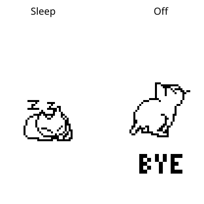

# Custom epaper status screen

## Layout

The upright content area is 88 pixels wide and 184 pixels tall. `widgets/util.h`
defines section heights and offsets in upright coordinates. Rotation is internal:
each displayed canvas is a native `height × 88` rectangle, while its drawing
callback receives an `88 × height` scratch canvas.

The active peripheral layout is:

| Section | Upright vertical range |
| --- | --- |
| `SECTION_STATUS` (battery/connection) | 0–23 |
| `SECTION_LAYER` | 24–43 |
| Free content area | **44–163** |
| `SECTION_MODIFIERS` | **164–183** |

The optional central screen also registers `SECTION_PROFILES` at 44–75.
`MODIFIER_OFFSET` is calculated from the screen length, independently of the
other sections. No canvas covers the free content area on the peripheral.

## Full redraw versus section redraw

All drawing and state changes must run on ZMK's display queue.

- `redraw_section(&widget->sections[SECTION_LAYER])` redraws just that piece
  from its cached state. A completed hidden scratch image is rotated into the
  fixed visible buffer and that section alone is invalidated.
- `zmk_widget_status_redraw(widget)` redraws every registered section and requests
  an explicit full-screen refresh. Initialization uses this path after loading
  the initial state.

Routine callbacks compare their new state with the cache before calling
`redraw_section()`. Modifier events do not redraw the layer, layer events do not
redraw modifiers, and repeated unchanged state does not invalidate either.
Registered sections have named references rather than LVGL child indices.

## Why presentation is custom

Zephyr's standard monochrome flush callback enables display blanking when LVGL
flushes more than one region in a frame. The SSD16xx driver switches to its full
refresh profile when blanking is enabled. Disjoint section updates would therefore
flash the whole panel, even with `CONFIG_LV_Z_FULL_REFRESH=n`.

`widgets/refresh.c` keeps LVGL's monochrome area rounding and converts its I1
pixels to the panel's monochrome layout, but presents ordinary windows as
independent partial updates. Multiple dirty sections can produce several partial
updates; they do not implicitly select the full waveform. Only
`epaper_refresh_full()` enables blanking until the last window is written.

With a debug build, `just logs` shows the native window coordinates and whether
the request is partial or full. The mono area-rounder can expand a window to
byte boundaries (for example, modifiers at 164–183 are flushed at 160–183).

## Adding a section

1. Choose an unused interval inside `[CONTENT_OFFSET, CONTENT_END)` and define
   its offset/height in `widgets/util.h`. Check that it does not overlap neighbors.
2. Add a named ID before `SECTION_COUNT`, and a buffer sized with
   `SECTION_BUF_SIZE(height)` to the appropriate widget structure. Include the
   height in `MAX_SECTION_HEIGHT` if it exceeds the current maximum.
3. Write a `section_draw_cb`: `(lv_obj_t *canvas, const void *context)`. Call
   `canvas = begin_canvas(canvas)`, draw within the section's upright bounds,
   then call `rotate_canvas(canvas)` to publish it. Use cached state in `context`.
4. Register it with `init_section()` in the widget's initialization. The full
   redraw path automatically includes registered sections.
5. Update its cached state and call `redraw_section()` only when that state changes.

Keep the modifier offset bottom-anchored. Adding a new section does not require
changing the modifier renderer or refresh implementation.

## Idle, sleep, and shutdown screens

The active `build.yaml` sets both halves to idle after **15 minutes** and deep
sleep after **30 minutes** since their last local activity. Idle keeps the normal
status screen. USB power prevents automatic deep sleep.

On automatic deep sleep the left shows a sleeping Neko cat with Zs. Manual
shutdown shows Neko heading away with `BYE`. The monochrome sprite data is in
`widgets/power_art.c`; it renders directly into a small static I1 buffer in native
orientation. It does not allocate a full-screen L8 scratch image. A separate
LVGL root keeps late battery, connection, and layer updates off the final image.

### Neko artwork

The cat sprites come from [adryd325/oneko.js](https://github.com/adryd325/oneko.js),
revision `5281d057c4ea9bd4f6f997ee96ba30491aed16c0`, under its MIT license
(Copyright © 2022 adryd). The complete notice is preserved in
[`widgets/LICENSE.oneko`](widgets/LICENSE.oneko).

The source is [`oneko.gif`](https://raw.githubusercontent.com/adryd325/oneko.js/5281d057c4ea9bd4f6f997ee96ba30491aed16c0/oneko.gif)
(SHA-256 `f4c5688eb8ee6f22b08ab8df361222307dc6fe2d5bdcfa12582cea694707e66d`).
Using zero-based 32 × 32 cells, sleep uses column 2 / row 0 (`sleeping[0]`),
and shutdown uses column 0 / row 3 (`NE[1]`). Transparent and white pixels become
background; black pixels become foreground. Each sprite is scaled exactly 2× to
64 × 64, with no smoothing or dithering. The sleeping frame includes its own Zs;
only shutdown adds the existing `BYE` caption. Both screens are static.

### Refresh ordering

`power.c` replaces the external module's `SPLITKB_VIK_SLEEP` handler for this
shield. At boot it enables only the VIK power supply at `POST_KERNEL` /
`CONFIG_KERNEL_INIT_PRIORITY_DEVICE`, before the DBI and SSD1680 drivers initialize.
Those drivers own RESET, CS, DC and BUSY during startup and normal operation.
Enabling the supply at `APPLICATION` is too late: the controller would receive its
initial reset/configuration while unpowered, leaving all screen updates frozen.
Build assertions require the early power priority to precede both driver priorities.

Sleep is handled in a defined order: queue the final screen, synchronously refresh
it, wait for the SSD1680 BUSY line to clear, and only then release the pins. The dedicated display
queue is required: the activity/shutdown worker waits for it to finish. Display
errors and a final BUSY wait exceeding ten seconds are logged; shutdown still
proceeds, consistent with this board's power-off-on-suspend-failure setting.

### Manual shutdown

Hold both outer Enter thumb keys to access Adjust, then **press and release O**.
The `&pwroff` behavior sends shutdown to both connected halves. The dongle stays
powered. The left finishes drawing `BYE`, and each half enters ZMK soft-off with
normal key wake disabled. Wait for the image to finish before switching off the
battery switches. The e-paper retains its image without power.

Automatic sleep wakes on a key; manual soft-off needs a reset or power cycle.
For a battery-switch power cycle, disconnect USB from the halves too: USB can
continue supplying power with the battery switch off. To trigger shutdown, the
halves must be awake and connected to the dongle. See the
[split behavior documentation](../mod_split_state_sync/README.md#manual-shutdown).

## Verification

`python3 -B -m unittest discover -s tests -p 'test_power.py'` checks production
boot registration/order, supply enable before simulated driver initialization,
GPIO readiness/setup failures, shutdown routing, sleep-versus-off selection,
display completion before pin release, and artwork bounds with padded strides.
It uses host adapters, not a
physical panel.

Build all targets with `nix develop -c just build`, then flash all three UF2s.
On hardware, check:

1. At 15 minutes on battery, the status screen remains visible.
2. At 30 minutes, the sleeping cat finishes drawing before the left disconnects;
   a key wakes the half and restores the normal screen.
3. Adjust + O shows `BYE` and shuts down both halves. Normal keys do not wake them.
4. Turning both battery switches off preserves `BYE`; powering back on restores
   the normal screen and Bluetooth connections.
5. USB power prevents automatic sleep, but does not prevent manual shutdown.
6. Battery/connection updates during the final refresh do not overwrite the cat.

For a faster hardware check, temporarily override both timeout CMake arguments
in `build.yaml` (for example, 10000 and 20000 milliseconds), then restore the
15/30-minute values and rebuild before normal use.
